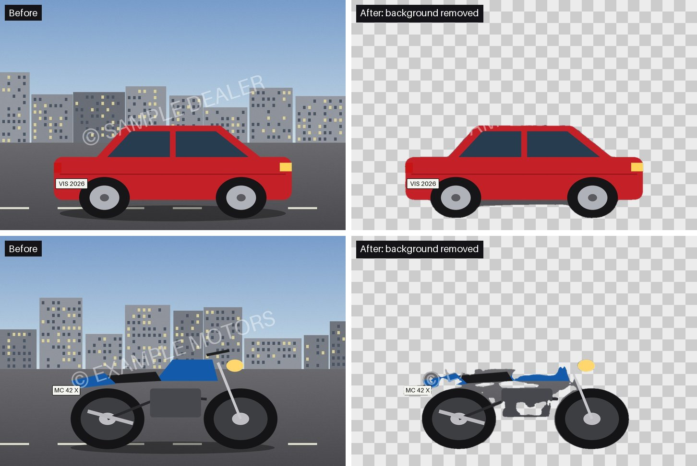
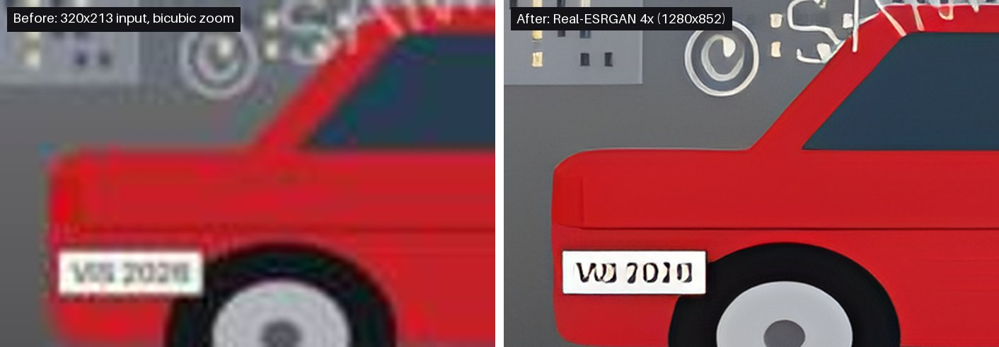
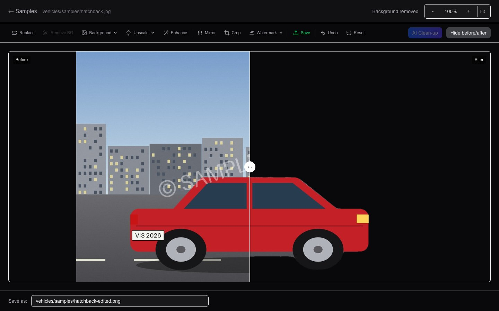
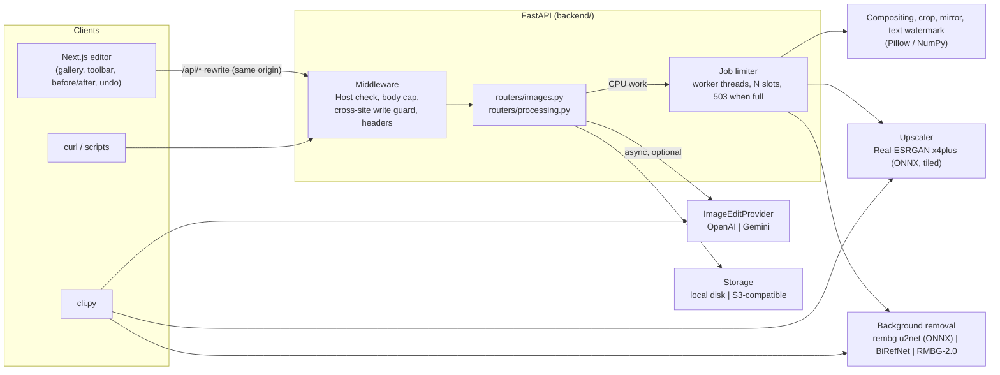

# Vehicle Image Studio

Background removal, Real-ESRGAN upscaling and AI number-plate/watermark clean-up for vehicle photos, behind one HTTP API, one CLI and a browser editor. The first two run offline on a CPU; the generative step is optional and pluggable.

[](https://github.com/himanshumehta/vehicle-image-studio/actions/workflows/ci.yml)
[](LICENSE)


## Demo

Background removal with the default `u2net` model on the bundled synthetic samples. Outputs are unedited, including the mistakes on the motorcycle:



Real-ESRGAN 4x on a 320x213 JPEG, next to a plain bicubic zoom of the same crop:



The editor after one click on **Remove BG**, with the before/after slider:



## Why it exists

Listing and review sites receive vehicle photos with busy backgrounds, low resolution, readable number plates and other people's watermarks. Fixing that by hand takes minutes per image and does not scale to a catalogue. The constraints were: run on an ordinary laptop with no GPU, keep the default path free of API keys and of non-commercial model licences, and make the one step that needs a generative model (inpainting plates and watermarks) optional, swappable between vendors and visible to a human before anything is saved.

## Architecture



A request carries either an uploaded image or a storage key. The router validates it (size, format, pixel count, key shape), hands the CPU-bound part to a worker thread under the job limiter, and streams back a PNG. The editor keeps every result as a `blob:` URL with an undo stack and writes to storage only when the user clicks **Save**.

| Component | Responsibility | Key file |
|---|---|---|
| HTTP hardening | Host allow-list, request-size cap (also for chunked bodies), refusal of cross-site writes, security headers | `backend/http_security.py` |
| Gallery API | List, import, save, delete, serve stored images; key validation | `backend/routers/images.py`, `backend/services/storage.py` |
| Processing API | One endpoint per operation; maps service errors to 400/413/503/500 | `backend/routers/processing.py` |
| Job limiter | Runs model work off the event loop with a bounded number of slots | `backend/services/jobs.py` |
| Background removal | Model selection, lazy loading, shared mask refinement | `backend/services/background_removal.py` |
| Upscaler | Tiled Real-ESRGAN on ONNX Runtime, 2x/4x/8x, alpha preserved, output-size guard | `backend/services/upscale_service.py` |
| Image-edit providers | Adapter interface, OpenAI and Gemini implementations, clean-up presets, factory with fallback | `backend/image_edit_providers/` |
| Untrusted image decoding | Format allow-list, pixel limit checked from the header, bomb warnings as errors | `backend/utils/image_helpers.py` |
| Model setup | Downloads weights, verifies SHA-256, exports Real-ESRGAN to ONNX | `backend/scripts/download_models.py` |
| Editor state | Undo stack, blob lifetime, "operate on the current result or the stored original" | `frontend/src/hooks/useProcessing.ts` |
| API client | One `processImage` helper, typed responses, retry with backoff | `frontend/src/lib/api.ts` |

## Design decisions and trade-offs

**Provider adapter for generative edits.**
*Why:* plate and watermark removal needs an inpainting model, and the best one changes every few months. `ImageEditProvider` is a small abstract class (`edit_image`, `check_available`); OpenAI and Gemini implement it, and a factory returns the configured provider or falls back to whichever has a key. Plate/watermark removal is a named prompt preset on top, so the UI and CLI never mention a vendor.
*Trade-off:* the interface is the lowest common denominator. Provider-specific features such as OpenAI's mask parameter are not used, so the model decides where to edit.

**ONNX Runtime on the CPU for the deterministic steps.**
*Why:* rembg's `u2net` and an ONNX export of Real-ESRGAN run with no torch at runtime, give the same output on every machine (the CoreML provider is deliberately not used), and keep the runtime install small.
*Trade-off:* slow for large images (see Results), and torch is still needed once, at setup, to export Real-ESRGAN. A pre-converted ONNX download would avoid that, but this repo prefers the official `.pth`, verified by SHA-256 and converted locally.

**Licence-aware model choice.**
*Why:* the default `u2net` is Apache-2.0. BRIA RMBG-2.0 segments better but its weights are CC BY-NC 4.0 (non-commercial), so it is opt-in through `BG_REMOVAL_MODEL=rmbg-2.0`, gated behind `HF_TOKEN`, and never downloaded otherwise.
*Trade-off:* the default produces worse masks on hard images (holes in the motorcycle above). BiRefNet (MIT code) is offered as the better permissive option.

**Tiled super-resolution with an explicit output budget.**
*Why:* Real-ESRGAN runs on 256 px tiles with 32 px reflect padding and overlap averaging, so a tile's memory is constant. 2x is a 4x pass then Lanczos down; 8x is two chained passes. The accumulators still scale with the output, so requests whose network output would exceed `MAX_UPSCALE_OUTPUT_PIXELS` (25 MP by default) are refused with a 413 before any inference.
*Trade-off:* 8x is limited to small inputs (about 97,000 pixels, e.g. 380x256) unless the limit is raised.

**One mask refinement for every segmentation model.**
*Why:* soft mask edges keep the original background colour and show up as a halo when composited. Threshold, 1 px erode and a light blur remove it regardless of model.
*Trade-off:* hair-thin structures (mirror stalks, spokes) can lose a pixel of width.

**Model work in worker threads behind a concurrency limit.**
*Why:* inference takes seconds to minutes. Running it inside `async def` handlers would freeze the server, file serving included. Jobs run in threads; at most `MAX_CONCURRENT_JOBS` (default 1, since ONNX Runtime already uses every core) run at once, and a request that waits more than `JOB_QUEUE_TIMEOUT_S` gets `503` with `Retry-After`.
*Trade-off:* no job queue or progress reporting; a long upscale holds an HTTP request open (the Next.js proxy timeout is raised to 10 minutes for this).

**Same-origin UI and a key-checked store.**
*Why:* the browser only talks to the Next.js server, which rewrites `/api/*` to FastAPI, so CORS is not needed in normal use. Storage keys are validated in one function for both backends, which makes the local file server safe to expose to that proxy.
*Trade-off:* images from S3 are fetched through presigned URLs, so the UI's CSP must allow `https:` images.

## AI in the loop

- **Where models sit.** Segmentation (u2net, BiRefNet or RMBG-2.0) and super-resolution (Real-ESRGAN) are local, deterministic per machine, and free. The generative step (OpenAI `gpt-image-1` or Gemini `gemini-2.5-flash-image`) is remote, non-deterministic and billed per call.
- **Guardrails on the input.** The image must decode as JPEG/PNG/WebP within the size and pixel limits before a paid call is made. Presets carry fixed prompts that ask the model to change only the plate or watermark; free-form prompts are capped at 2,000 characters; every prompt is wrapped in a fixed system context about preserving the vehicle.
- **Validation of the output.** The returned bytes are parsed as an image (Gemini's are re-encoded to PNG) before they reach the client. The response carries `X-Edit-Provider`, `X-Edit-Model` and a per-call cost estimate in `X-Edit-Cost-USD` (a fixed table per quality level, not a billing figure).
- **Human in the loop.** Every result, local or generative, lands in the editor as an unsaved version with undo and a before/after slider. Nothing is written to storage until the user clicks Save, and the AI panel is disabled unless a key is configured.
- **Cost and latency controls.** The UI does not retry AI edits (each retry would be billed); provider clients have a 120 s timeout, and the OpenAI client retries at most once. Rate-limit and timeout errors map to `429` so the user can try later; everything else is `502` with a short message, the full provider error going to the server log.
- **Fallbacks.** With no key the studio still works offline. With two keys, `IMAGE_EDIT_PROVIDER` picks the default and the other is used if the preferred one is not configured.
- **Evaluation.** The adapters are tested with stub clients (request shape, size selection, error classification, secret-free messages), and an offline eval suite ([Evals](#evals)) scores edit preservation outside the plate/watermark mask, background-removal masks against exact ground truth, and the input guards. There is no automated quality eval of live generative outputs.

## Reliability and operations

- **Failure modes.** Missing Real-ESRGAN weights trigger a one-off download/export in a subprocess (900 s timeout); if that fails the API answers `503` with the setup command and logs the details. Missing optional dependencies for BiRefNet/RMBG-2.0 also give a `503`. Unexpected errors give `500` with a generic message and a logged traceback.
- **Retries.** The UI retries network errors, `429` and `5xx` twice with exponential backoff (500 ms, 1 s), which covers the job limiter's `503`. Processing calls are idempotent: they return a new image and never write to storage.
- **Model loading.** Models load lazily on first use, under a lock so concurrent first requests load once. `GET /api/process/health` reports the configured model and whether each model is loaded.
- **Observability.** Python `logging` at INFO: model loads, upscale sizes, job failures with tracebacks, provider errors. There are no metrics endpoints.
- **Configuration.** Environment variables or a `.env` at the repository root (table below); relative paths resolve from the repository root, not the working directory.

## Security

The API has **no authentication** and is meant for a single user on their own machine. Within that model it defends against: drive-by writes from other websites (multipart POSTs skip CORS preflight, so cross-site writes are refused), DNS rebinding (Host allow-list), path traversal and stored XSS through storage keys, decompression bombs and oversized bodies, CPU/RAM exhaustion from parallel or oversized jobs, error messages that leak paths, and tampered weights (SHA-256 pins, `torch.load(weights_only=True)`, pinned revisions for `trust_remote_code` models). CI runs `pip-audit`, `npm audit`, Bandit and Gitleaks. Details, scope and how to report a vulnerability: [SECURITY.md](SECURITY.md).

## Quickstart

Needs Python 3.11+ (tested on 3.11), Node.js 20+, git and about 2.5 GB of disk (see Results). No API keys.

```bash
git clone https://github.com/himanshumehta/vehicle-image-studio.git
cd vehicle-image-studio

# 1. Backend dependencies
python3.11 -m venv backend/.venv
source backend/.venv/bin/activate
pip install -r backend/requirements.txt
# torch is needed once, to export Real-ESRGAN to ONNX (CPU wheels are enough)
pip install -r backend/requirements-models.txt --extra-index-url https://download.pytorch.org/whl/cpu

# 2. Models: u2net (~176 MB, to $U2NET_HOME, default ~/.rembg) and Real-ESRGAN
#    (~64 MB .pth, verified, exported to backend/models/realesrgan_x4plus.onnx)
python backend/scripts/download_models.py

# 3. Offline demo on the bundled samples: results land in out/
cd backend
python cli.py remove-bg ../samples/hatchback.jpg ../out/hatchback-nobg.png
python cli.py upscale ../samples/hatchback-small.jpg ../out/hatchback-small-4x.png --scale 4
cd ..
```

Run the API and call it:

```bash
# Terminal 1: API on :8000 (the sample images are copied into data/storage/ on first start)
source backend/.venv/bin/activate
cd backend && uvicorn main:app --port 8000

# Terminal 2
curl -o out/motorcycle-nobg.png -F file=@samples/motorcycle.jpg http://localhost:8000/api/process/remove-background
curl -o out/hatchback-small-2x.png -F file=@samples/hatchback-small.jpg -F scale=2 http://localhost:8000/api/process/upscale
```

Then the UI, in another terminal:

```bash
cd frontend && npm ci && npm run dev    # http://localhost:3000
```

Choose **Samples**, open `hatchback.jpg`, click **Remove BG**, then **Before/after**. **Upscale → 4x** on `hatchback-small.jpg` shows the upscaler. **Save** writes the result next to the original in `data/storage/`.

If port 8000 or 3000 is taken, start uvicorn with another `--port` and run the UI with `BACKEND_URL=http://localhost:<api-port> npm run dev -- --port <ui-port>`. Interactive API docs are at `http://localhost:8000/docs`.

Optional plate and watermark removal: copy `.env.example` to `.env` and set `OPENAI_API_KEY` or `GEMINI_API_KEY`. The **AI Clean-up** panel is then enabled, or use the CLI (this call is billed by the provider):

```bash
cd backend && python cli.py clean ../samples/hatchback.jpg ../out/hatchback-clean.png --preset remove_plate_and_watermark
```

## Configuration

All variables are optional. Put them in `.env` at the repository root (see [`.env.example`](.env.example)) or export them.

| Variable | Default | Purpose |
|---|---|---|
| `STORAGE_BACKEND` | `local` | `local` (disk) or `s3` (any S3-compatible store) |
| `LOCAL_STORAGE_DIR` | `./data/storage` | Image root for local storage |
| `SEED_SAMPLES` | `true` | Copy `samples/*.jpg` into an empty local store on startup |
| `S3_BUCKET`, `S3_REGION`, `S3_ENDPOINT_URL` | empty, `us-east-1`, empty | Bucket settings for `STORAGE_BACKEND=s3`; empty endpoint means AWS |
| `S3_ACCESS_KEY_ID`, `S3_SECRET_ACCESS_KEY` | empty | S3 credentials; empty falls back to the default boto3 credential chain |
| `BG_REMOVAL_MODEL` | `u2net` | `u2net`, `isnet-general-use`, `birefnet-general` (rembg), `birefnet` or `rmbg-2.0` (transformers) |
| `HF_TOKEN` | empty | Hugging Face token, only for the gated `rmbg-2.0` |
| `MODELS_DIR` | `./backend/models` | Where `realesrgan_x4plus.onnx` is written and read |
| `U2NET_HOME` | `~/.rembg` | rembg's model cache, read by rembg itself (`REMBG_HOME` also works; files land in `<dir>/models/<name>/`) |
| `MAX_IMAGE_PIXELS` | `40000000` | Largest decoded input image |
| `MAX_UPSCALE_OUTPUT_PIXELS` | `25000000` | Largest image the upscaler network may produce for one request |
| `MAX_CONCURRENT_JOBS` | `1` | Model/image jobs running at once |
| `JOB_QUEUE_TIMEOUT_S` | `30` | How long a request waits for a job slot before `503` |
| `IMAGE_EDIT_PROVIDER` | `openai` | Preferred AI edit provider when both keys are set |
| `OPENAI_API_KEY`, `OPENAI_IMAGE_MODEL` | empty, `gpt-image-1` | Enables OpenAI image edits |
| `GEMINI_API_KEY`, `GEMINI_IMAGE_MODEL` | empty, `gemini-2.5-flash-image` | Enables Gemini image edits |
| `CORS_ORIGINS` | `http://localhost:3000` | Origins allowed to call the API directly from a browser |
| `ALLOWED_HOSTS` | `localhost,127.0.0.1` | Accepted `Host` headers; add your hostname when not on localhost, `*` disables the check |
| `BACKEND_URL` | `http://localhost:8000` | Read by `next dev` / `next build`: where `/api/*` is proxied |

## Testing

```bash
(cd backend && pytest -q)                                  # 111 tests
(cd frontend && npm test)                                  # 70 tests (vitest)
(cd frontend && npm run lint && npx tsc --noEmit && npm run build)
```

Backend tests run without weights or network: models are replaced by fakes (a nearest-neighbour stand-in checks the tiling arithmetic and seam handling), and the provider adapters use stub clients. They cover the routers end to end through ASGI, local storage, mask refinement, compositing, upscaling scales and alpha, and a security suite (`tests/test_security.py`: key validation, stored-XSS path, non-image uploads, body and pixel limits, cross-site writes, Host checks, CORS, job-limiter saturation, error redaction, pinned model revisions). Frontend tests cover the API client (form building, retry and error mapping), the processing hook's state machine and undo, keyboard shortcuts, zoom and the editor components. CI runs both suites, the offline evals (stub segmentation model, see [Evals](#evals)), a production build and the security scans on every push.

## Evals

```bash
python evals/run_evals.py                    # deterministic suites, stub segmentation model (what CI runs)
python evals/run_evals.py --bg-model u2net   # also scores the cached u2net; refuses to download weights
```

The runner writes [`evals/results.json`](evals/results.json) and [`evals/results.md`](evals/results.md) (`--out-dir` to change) and exits non-zero if a gate fails. It needs no network: provider keys are blanked before the app is imported, the Gemini adapter only sees API-shaped responses from a stub client, and the live segmentation run stops if the weights are not already cached. The fixtures are 20 scenes (960x640) drawn in code with the functions in `scripts/make_samples.py`, so the vehicle mask, plate box and watermark box are known exactly. The edit metric (`evals/metrics.py`) counts a pixel as changed when an RGB channel moves by more than 8/255, ignores a 3 px margin around the mask, and passes an edit when at most 1% of the outside pixels changed, the PSNR outside is at least 35 dB, and at least 5% of the masked pixels changed. These thresholds are design choices, not calibrated on real model outputs.

Measured with `--bg-model u2net` on the Apple M2 Max from [Results](#results) (macOS 26.7.2, load average about 15, so the timing is an upper bound), in the local venv (Python 3.11.13, Pillow 11.1.0, rembg 2.0.61, ONNX Runtime 1.31.1, google-genai 2.34.0; older than some pins in `requirements.txt`). 28/28 gates passed. Ranges are min to max over the 20 scenes:

| Check | Measured | Gate |
|---|---|---|
| Good edit: inpaint only the plate and watermark boxes | 0% of outside pixels changed; 20/20 pass | must pass |
| Bleeding edit: the same boxes grown by 24 px | 1.1–3.5% changed outside, 9–30% in the 32 px ring round the mask, PSNR outside 20.8–32.9 dB; 20/20 flagged | must fail |
| Global colour shift after a good edit | 99.7–100% changed outside, 29.4 dB; 20/20 flagged | must fail |
| Output identical to the input | 0% changed inside the mask; 20/20 flagged as no edit | must be flagged |
| Good edit returned at 16:9 | 20/20 flagged as size mismatch | must be flagged |
| Good edit, then a whole-frame JPEG q92 re-encode | 0.7–2.6% changed outside, 39.3–43.0 dB; 11/20 flagged | informational |
| Gemini adapter on a recorded-shape success / blocked response | pixels returned unchanged, HTTP 200 / `ImageEditError`, HTTP 502 | must pass |
| Scoring harness with stub models: oracle / mask shifted 40 px / empty | mean IoU 0.974 / 0.695 / 0 (the oracle scores 0.974, not 1, because of the 1 px erode in `refine_mask`) | ordering must hold |
| **u2net** background removal, 20 scenes | **mean IoU 0.812** (0.456–0.991): cars 0.987, motorcycles 0.637; 0.41 s per image | reported, not gated |
| Input guards: non-image, GIF, BMP, TIFF, pixel bomb, >25 MB upload, upscale over the output limit, bad scale, junk before a paid call, long prompt, unknown preset, no key | 13/13 expected status codes; the upscaler and the paid provider were never called for a refused request | must pass |

What the evals found:

- **Fixed:** the Gemini adapter failed on every successful response. In google-genai, `Part.as_image()` returns the SDK's own `types.Image`, whose `save()` takes a file path, so the PNG re-encode raised `TypeError` (an HTTP 500). A blocked response (no `parts`) failed the same way instead of returning a clean 502. `gemini_editor.py` now reads `inline_data.data` directly; both cases have regression tests.
- **Fixed:** the Gemini adapter asked for 16:9 output for 3:2 inputs (the bundled 1200x800 samples) and for square inputs, and 3:4 for 2:3, so the result came back a different shape. Both providers now ask for the supported ratio closest to the photo on a log scale (portrait and landscape treated alike) and honour the EXIF orientation tag, so a sideways-stored phone photo is sent upright. OpenAI picks the nearest of its three sizes.
- u2net cuts out the car scenes well (IoU 0.974–0.991 on all 10) and does much worse on the motorcycles (0.456–0.692). On the worst one it kept background buildings and dropped the grey engine, in line with the holes visible in the demo above.
- The 1% gate also flags about half of the whole-frame JPEG re-encodes. That strictness suits a lossless pipeline; generative models redraw the whole frame, so the thresholds would need calibrating on real outputs.

Not covered: live Gemini inpainting quality (needs a calibrated vision judge and API access), and the same for OpenAI. The "recorded" Gemini responses are API-shaped JSON around a synthetic image: they test the adapter's parsing and that it passes pixels through, not the model. The repo has no deterministic plate or watermark detector (the model decides where to edit), so detection is not evaluated; the masks come from the fixture geometry. BiRefNet and RMBG-2.0 were not run, Real-ESRGAN output quality is not scored, and the scenes are drawings, not photographs.

## Results

Measured on an Apple M2 Max (12 cores, 32 GB), macOS 26.7, Python 3.11, ONNX Runtime 1.31 on the CPU (BiRefNet: torch 2.15, transformers 5.22). The machine was shared with other workloads during the run (load average about 22), so read these as upper bounds. "CLI" is the wall-clock time of one `cli.py` run including Python start-up and model loading; "API" is `curl`'s total time against a running server, with the model already loaded unless the row says otherwise.

| Operation | Input | Output | Path | Time |
|---|---|---|---|---|
| Background removal, `u2net` | 1200x800 `hatchback.jpg` | 1200x800 RGBA PNG | CLI | 5.2 s |
| Background removal, `u2net` | 1200x800 `motorcycle.jpg` | 1200x800 RGBA PNG | CLI | 4.0 s |
| Background removal, `u2net` | 1200x800 `hatchback.jpg` | 1200x800 RGBA PNG | API, model loaded | 0.42 s |
| Real-ESRGAN 2x | 320x213 | 640x426 | CLI | 15.0 s |
| Real-ESRGAN 4x | 320x213 | 1280x852 | CLI | 13.4 s |
| Real-ESRGAN 8x | 320x213 | 2560x1704 | CLI | 185.7 s |
| Real-ESRGAN 2x | 320x213 | 640x426 | API, first call incl. model load | 13.8 s |
| Real-ESRGAN 2x | 1200x800 RGBA | 2400x1600 RGBA | API | 168.7 s |
| BiRefNet (`BG_REMOVAL_MODEL=birefnet`, torch on Apple MPS, weights cached) | 1200x800 `hatchback.jpg` | 1200x800 RGBA PNG | CLI | 8.4 s |

2x costs as much as 4x because it is a 4x pass followed by a downscale. A clean-clone setup (core and model requirements, both models, `npm ci`) used 2.4 GB: 1.7 GB Python venv with CPU torch, 523 MB `node_modules`, 168 MB rembg cache, 64 MB Real-ESRGAN ONNX.

Model files on disk after setup: `u2net.onnx` 175,997,641 bytes; `realesrgan_x4plus.onnx` 67,051,808 bytes, exported from the 67,040,989-byte official `RealESRGAN_x4plus.pth`.

## Project layout

```text
backend/
  main.py                  app, middleware order
  http_security.py         body cap, cross-site write guard, security headers
  config.py                settings (env / .env)
  cli.py                   remove-bg | upscale | clean
  routers/                 images.py (gallery, files), processing.py, uploads.py
  services/                background_removal, upscale_service, jobs, storage,
                           studio_compositor, watermark, errors
  image_edit_providers/    base (interface, presets), openai_editor, gemini_editor
  utils/image_helpers.py   untrusted image decoding
  scripts/download_models.py
  tests/
frontend/src/
  app/                     gallery and editor pages
  components/editor/       toolbar, canvas, crop, before/after, AI panel
  hooks/useProcessing.ts   editor state machine
  lib/api.ts               API client
samples/                   synthetic test images (scripts/make_samples.py)
scripts/make_readme_images.py
evals/                     run_evals.py, metrics.py, fixtures.py, results.json/.md
```

## Limitations and roadmap

- **CPU only.** Large upscales take minutes and hold one HTTP request open. A job queue with progress events (and CUDA/CoreML execution providers behind a flag) is the obvious next step.
- **Masks have holes.** `u2net` is a general salient-object model: it handles the car sample but leaves gaps in the motorcycle and keeps part of the watermark on the car roof. `BG_REMOVAL_MODEL=birefnet` does better at the cost of torch at runtime and a larger download.
- **Upscalers invent detail.** In the demo, the plate text "VIS 2026" comes out of the 4x upscale as different characters. Never treat an upscaled plate, label or serial number as evidence.
- **Generative clean-up is unverified.** It can alter other parts of the image, it costs money, and the image is sent to a third party. The adapters are tested against stubs only; no live call is part of this repository's tests.
- **Single user, no auth.** See [SECURITY.md](SECURITY.md). Multi-user use needs authentication, per-user storage prefixes and per-client rate limits.
- **Synthetic samples.** The samples are drawings made by `scripts/make_samples.py`, not photographs; expect different (usually better) segmentation on real photos.

## Licence

The code is MIT-licensed ([LICENSE](LICENSE)). Model weights are not in the repository; they are downloaded at setup and carry their own licences:

| Model / library | Used for | Licence | Source |
|---|---|---|---|
| U²-Net `u2net` (default) | Background removal | Apache-2.0 | https://github.com/xuebinqin/U-2-Net |
| DIS `isnet-general-use` | Background removal (opt-in) | Apache-2.0 | https://github.com/xuebinqin/DIS |
| BiRefNet | Background removal (opt-in) | MIT (code licence) | https://github.com/ZhengPeng7/BiRefNet |
| **BRIA RMBG-2.0** | Background removal (opt-in) | **CC BY-NC 4.0, non-commercial only** | https://huggingface.co/briaai/RMBG-2.0 |
| Real-ESRGAN x4plus | Upscaling | BSD-3-Clause | https://github.com/xinntao/Real-ESRGAN |
| rembg | Model runner | MIT | https://github.com/danielgatis/rembg |

RMBG-2.0 is gated on Hugging Face (accept BRIA's terms and set `HF_TOKEN`), commercial use needs a separate agreement with BRIA, and it is never downloaded unless `BG_REMOVAL_MODEL=rmbg-2.0`. The U²-Net, DIS, BiRefNet and Real-ESRGAN repositories state a licence for their code but not separately for their weights; check them before commercial use. The OpenAI and Gemini APIs are covered by their providers' terms. The UI uses the system font stack; no fonts are bundled.

## Author

Built by **Himanshu Mehta** — staff engineer, 10+ years building large-scale distributed systems at Outreach, Builder.ai and Twilio; now building agentic AI systems. [LinkedIn](https://www.linkedin.com/in/himanshu-mehta-29920525) · [GitHub](https://github.com/himanshumehta)

Related projects: [data-to-video](https://github.com/himanshumehta/data-to-video) · [social-publisher](https://github.com/himanshumehta/social-publisher) · [vehicle-image-studio](https://github.com/himanshumehta/vehicle-image-studio) · [multi-brand-design-system](https://github.com/himanshumehta/multi-brand-design-system)
