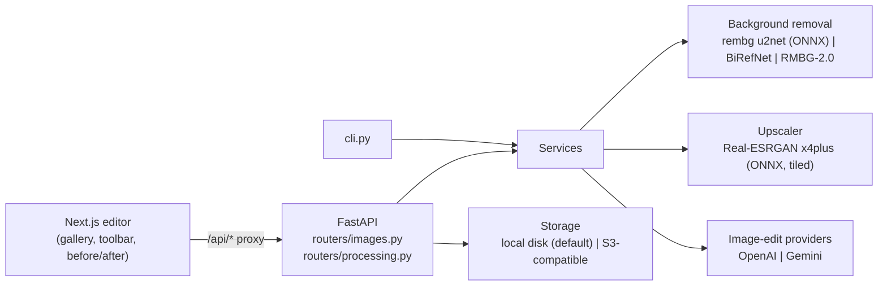

# Vehicle Image Studio

An AI studio that cleans up vehicle photos: background removal, 2–8x upscaling, number-plate and watermark removal.

## Demo

Background removal with the default `u2net` model (run on the bundled synthetic samples; the outputs are shown unedited, including the mistakes on the motorcycle):


Real-ESRGAN 4x on a 320x213 JPEG, compared with a plain bicubic zoom of the same crop:


The editor's before/after slider after one click on **Remove BG**:


## Why it exists

Listing and review sites get vehicle photos with busy backgrounds, low resolution, readable number plates and other people's watermarks. Fixing that by hand in a photo editor takes minutes per image and does not scale to a catalogue. This studio puts the three fixes behind one UI, one HTTP API and one CLI, runs the first two fully offline, and keeps the paid AI step optional.

## Architecture



## Key ideas

- **Provider adapter for AI edits.** `ImageEditProvider` is a small abstract class; OpenAI and Gemini implement it, and a factory picks the configured one or falls back to whichever has a key. Plate and watermark removal are named prompt presets on top of that interface (`backend/image_edit_providers/`).
- **One switch for the segmentation model.** `BG_REMOVAL_MODEL` selects any rembg ONNX model (no torch at runtime) or a Hugging Face transformers model (BiRefNet, RMBG-2.0), which is imported only when chosen.
- **Tiled super-resolution with flat memory.** Real-ESRGAN runs on 256 px tiles with 32 px reflect padding and overlap averaging. 2x is 4x then Lanczos down, 8x is two chained passes, and an alpha channel survives the round trip (`backend/services/upscale_service.py`).
- **Halo-free cut-outs.** Every model's soft mask goes through the same threshold, 1 px erode and light blur, which removes the light fringe that cut-outs of studio shots usually carry.
- **Swappable storage.** Local disk is the default and is served through `/api/files/...`, so the browser only ever talks to the Next.js proxy. Keys are checked so they cannot escape the storage root. Any S3-compatible bucket can be swapped in with `STORAGE_BACKEND=s3`.
- **No weights in git.** Models are downloaded at setup (the Real-ESRGAN weights are checked against a SHA-256) and lazy-loaded on the first request.

## Quickstart

Needs Python 3.10–3.12 (rembg 2.0.61 does not support 3.13), Node.js 20+ and about 2.5 GB of disk (measured: 1.6 GB Python venv with CPU torch, 0.46 GB `node_modules`, 0.24 GB models). No API keys are needed.

```bash
git clone <repo-url> vehicle-image-studio
cd vehicle-image-studio

# 1. Backend dependencies
python3.11 -m venv backend/.venv
source backend/.venv/bin/activate
pip install -r backend/requirements.txt
# torch is needed once, to export Real-ESRGAN to ONNX (CPU wheels are enough)
pip install -r backend/requirements-models.txt --extra-index-url https://download.pytorch.org/whl/cpu

# 2. Download the models: u2net (~176 MB, to ~/.u2net) and Real-ESRGAN (~64 MB, to backend/models/)
python backend/scripts/download_models.py

# 3. Offline demo on the bundled samples: before/after files land in out/
cd backend
python cli.py remove-bg ../samples/hatchback.jpg ../out/hatchback-nobg.png
python cli.py upscale ../samples/hatchback-small.jpg ../out/hatchback-small-4x.png --scale 4
cd ..
```

Run the app in two terminals:

```bash
# Terminal 1: API on :8000 (the sample images are copied into data/storage/ on first start)
source backend/.venv/bin/activate
cd backend && uvicorn main:app --port 8000

# Terminal 2: UI on :3000
cd frontend && npm ci && npm run dev
```

Open http://localhost:3000, choose **Samples**, open `hatchback.jpg`, then click **Remove BG** and **Before/after**. **Upscale → 4x** on `hatchback-small.jpg` shows the upscaler. **Save** writes the result next to the original in `data/storage/`.

The same operations over HTTP:

```bash
curl -o out/motorcycle-nobg.png -F file=@samples/motorcycle.jpg http://localhost:8000/api/process/remove-background
curl -o out/hatchback-small-2x.png -F file=@samples/hatchback-small.jpg -F scale=2 http://localhost:8000/api/process/upscale
```

If ports 8000 or 3000 are taken, start uvicorn with another `--port` and point the UI at it: `BACKEND_URL=http://localhost:<api-port> npm run dev -- --port <ui-port>`.

Optional plate and watermark removal: put `OPENAI_API_KEY` or `GEMINI_API_KEY` in `.env` (copy `.env.example`). The **AI Clean-up** panel is then enabled, or you can use the CLI:

```bash
cd backend && python cli.py clean ../samples/hatchback.jpg ../out/hatchback-clean.png --preset remove_plate_and_watermark
```

Tests: `cd backend && pytest` and `cd frontend && npm test`.

## Configuration

All variables are optional. Put them in `.env` at the repository root (see [`.env.example`](.env.example)) or export them.

| Variable | Default | Purpose |
|---|---|---|
| `STORAGE_BACKEND` | `local` | `local` (disk) or `s3` (any S3-compatible store) |
| `LOCAL_STORAGE_DIR` | `./data/storage` | Image root for local storage; relative paths resolve from the repo root |
| `SEED_SAMPLES` | `true` | Copy `samples/*.jpg` into an empty local store on startup |
| `S3_BUCKET`, `S3_REGION`, `S3_ENDPOINT_URL` | empty, `us-east-1`, empty | Bucket settings when `STORAGE_BACKEND=s3`; endpoint empty means AWS |
| `S3_ACCESS_KEY_ID`, `S3_SECRET_ACCESS_KEY` | empty | S3 credentials (empty falls back to the default boto3 credential chain) |
| `BG_REMOVAL_MODEL` | `u2net` | `u2net`, `isnet-general-use`, `birefnet-general` (rembg), `birefnet` or `rmbg-2.0` (transformers) |
| `HF_TOKEN` | empty | Hugging Face token, needed only for the gated `rmbg-2.0` |
| `MODELS_DIR` | `./backend/models` | Where `realesrgan_x4plus.onnx` is written and read |
| `U2NET_HOME` | `~/.u2net` | rembg's model cache (read by rembg itself) |
| `IMAGE_EDIT_PROVIDER` | `openai` | Preferred AI edit provider when both keys are set |
| `OPENAI_API_KEY`, `OPENAI_IMAGE_MODEL` | empty, `gpt-image-1` | Enables OpenAI image edits |
| `GEMINI_API_KEY`, `GEMINI_IMAGE_MODEL` | empty, `gemini-2.5-flash-image` | Enables Gemini image edits |
| `CORS_ORIGINS` | `http://localhost:3000` | Comma-separated origins allowed to call the API directly |
| `BACKEND_URL` | `http://localhost:8000` | Read by `next dev` / `next build`: where `/api/*` is proxied |

## Results

Measured on an Apple M2 Max with ONNX Runtime on the CPU (Python 3.11). Times are the wall-clock time of a single `cli.py` run, including model loading:

| Operation | Input | Output | Time |
|---|---|---|---|
| Background removal, `u2net` | 1200x800 `hatchback.jpg` | 1200x800 RGBA PNG | 1.3 s |
| Background removal, `u2net` | 1200x800 `motorcycle.jpg` | 1200x800 RGBA PNG | 1.4 s |
| Real-ESRGAN 2x | 320x213 | 640x426 | 12.7 s |
| Real-ESRGAN 4x | 320x213 | 1280x852 | 12.1 s |
| Real-ESRGAN 8x | 320x213 | 2560x1704 | 183.5 s |
| Real-ESRGAN 2x through the API | 1200x800 RGBA | 2400x1600 RGBA | 150.9 s |

Model files on disk: `u2net.onnx` 175,997,641 bytes; `realesrgan_x4plus.onnx` 67,051,808 bytes, exported from the 67,040,989-byte official `RealESRGAN_x4plus.pth`.

Test suites: 45 backend tests (`pytest`) and 76 frontend tests (`vitest`).

## Status, limits and licence

**Status.** A working single-user local tool. There is no authentication, so do not expose the API to a network you do not trust.

**Limits.**
- Everything runs on the CPU, so upscaling large images is slow (see Results). 8x upscaling of anything bigger than a thumbnail takes minutes.
- `u2net` is a general-purpose salient-object model. It handles the car sample well but leaves holes in the motorcycle and drops part of the watermark onto the car roof. Try `BG_REMOVAL_MODEL=birefnet-general` or `birefnet` for harder images.
- Super-resolution invents detail. In the demo above, the plate text "VIS 2026" comes out of the 4x upscale as different characters, so never use an upscaled plate as evidence.
- Plate and watermark removal is done by a third-party generative model. It can change other parts of the image, it costs money per call, and the image is sent to that provider. The adapters are covered by tests only for the no-key path; a live Gemini call during development reached the API and was rejected with a 429 quota error, and the OpenAI path was not exercised live.
- The sample images are synthetic drawings made by `scripts/make_samples.py`, not photographs. Expect different (usually better) segmentation on real photos.

**Licence.** The code is MIT-licensed (see [LICENSE](LICENSE)). The model weights are not part of this repository; they are downloaded at setup and carry their own licences:

| Model | Used for | Licence | Source |
|---|---|---|---|
| U²-Net `u2net` (default) | Background removal | Apache-2.0 | https://github.com/xuebinqin/U-2-Net |
| DIS `isnet-general-use` | Background removal (opt-in) | Apache-2.0 | https://github.com/xuebinqin/DIS |
| BiRefNet | Background removal (opt-in) | MIT (code licence) | https://github.com/ZhengPeng7/BiRefNet |
| **BRIA RMBG-2.0** | Background removal (opt-in) | **CC BY-NC 4.0, non-commercial only** | https://huggingface.co/briaai/RMBG-2.0 |
| Real-ESRGAN x4plus | Upscaling | BSD-3-Clause | https://github.com/xinntao/Real-ESRGAN |
| rembg (library) | Model runner | MIT | https://github.com/danielgatis/rembg |

**About RMBG-2.0.** The MIT-licensed code here can download BRIA RMBG-2.0, whose weights are licensed CC BY-NC 4.0 for non-commercial use only. The download is gated on Hugging Face (you must accept BRIA's terms and set `HF_TOKEN`), and commercial use needs a separate agreement with BRIA. It is never downloaded unless you set `BG_REMOVAL_MODEL=rmbg-2.0`. The default `u2net` model is Apache-2.0.

The U²-Net, DIS, BiRefNet and Real-ESRGAN repositories state a licence for their code; their release pages do not state a separate licence for the weights. Check them yourself before commercial use. The OpenAI and Gemini APIs are covered by their providers' terms.
